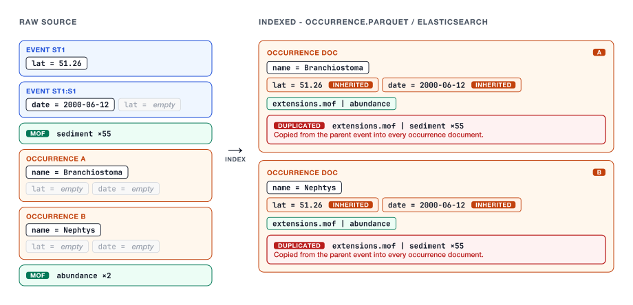
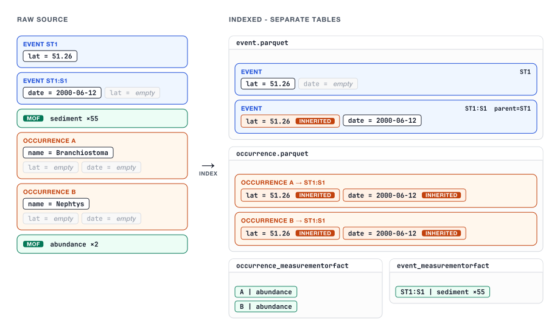
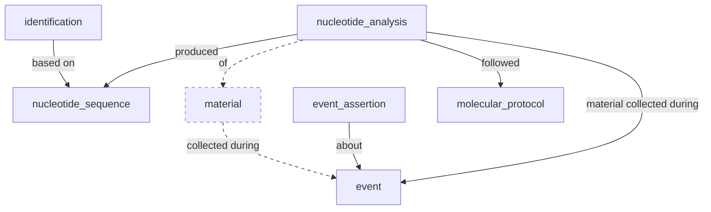
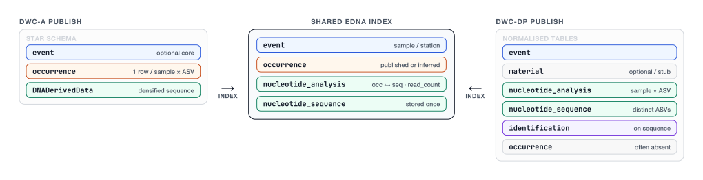

# OBIS and Darwin Core Data Package (DwC-DP)

DRAFT DOCUMENT

## What is Darwin Core Data Package (DwC-DP)?

Darwin Core Data Package is a community-developed container format to exchange biodiversity data. It extends the [Data Package specification](https://specs.frictionlessdata.io/) developed by Frictionless Data as an implementation for the [Darwin Core Conceptual Model](https://gbif.github.io/dwc-dp/cm/). It complements the [Darwin Core Archive (DwC-A)](https://ipt.gbif.org/manual/en/ipt/latest/dwca-guide) standard which is commonly used in OBIS and GBIF.

Documentation:

| Resource                          | URL                                                                        |
| --------------------------------- | -------------------------------------------------------------------------- |
| Darwin Core Conceptual Model      | <https://dwc.tdwg.org/cm/>                                                 |
| Darwin Core Data Package guide    | <https://dwc.tdwg.org/dp/>                                                 |
| Darwin Core Data Package Designer | <https://gbif.github.io/dwc-dp/designer/>                                  |
| DwC-DP table schemas              | <https://github.com/tdwg/rs.tdwg.org/tree/master/dwc-dp/1.0/table-schemas> |
| DwC-DP test IPT                   | <https://dwcdp-ipt.gbif-test.org>                                          |
| DwC-DP dataset examples           | <https://github.com/gbif/dwc-dp-examples>                                  |

## How data are indexed in OBIS now

Datasets are submitted to OBIS as DwC-A using either Event or Occurrence Core. Accepted extensions are DNADerivedData and (Extended)MeasurementOrFact. Datasets are converted to GeoParquet and indexed in ElasticSearch using an Occurrence centric data model. Occurrences inherit field values as well as extension records from linked event and parent event records. This inheritance potentially introduces mass duplication of extension records at the occurrence level, for example when many abiotic measurements are associated with sampling events. It was introduced for performance reasons, but is now causing issues related to data volume.

GBIF does not have this inheritance of extension records. For example, occurrence record <https://www.gbif.org/occurrence/3863984603> in GBIF only has a single extension record associated with it:

```json
{
  "key": 3863984603,
  "datasetKey": "2ecef267-0e17-4f3f-adf9-20b036e6167a",
  "publishingCountry": "GB",
  "extensions": {
    "http://rs.iobis.org/obis/terms/ExtendedMeasurementOrFact": [
      {
        "http://rs.tdwg.org/dwc/terms/measurementUnit": "Millimetres",
        "http://rs.tdwg.org/dwc/terms/measurementType": "standard length (mm)",
        "http://rs.tdwg.org/dwc/terms/occurrenceID": "AWI_PS69_494-4_1_234695_PS69_FF_0660",
        "http://rs.iobis.org/obis/terms/measurementUnitID": "https://vocab.nerc.ac.uk/collection/P06/current/UXMM/",
        "http://rs.tdwg.org/dwc/terms/measurementValue": "48"
      }
    ]
  },
  "basisOfRecord": "PRESERVED_SPECIMEN",
```

While [the OBIS record](https://api.obis.org/occurrence?scientificname=Notolepis%20coatsi\&startdate=2006-07-12\&enddate=2006-07-12\&mof=true) has event level extension records as well:

```json
{
  "catalogNumber": "PS69_FF_0660",
  "date_year": 2006,
  "decimalLatitude": -67.529,
  "decimalLongitude": -0.216,
  "mof": [
    {
      "measurementType": "standard length (mm)",
      "measurementUnit": "Millimetres",
      "measurementUnitID": "https://vocab.nerc.ac.uk/collection/P06/current/UXMM/",
      "measurementValue": "48",
      "occurrenceID": "AWI_PS69_494-4_1_234695_PS69_FF_0660",
      "level": 0
    },
    {
      "measurementType": "net number (i.e., six codends labelled from 1 to 6 or two nets labelled 1 to 2).",
      "measurementUnit": "Not applicable",
      "measurementUnitID": "https://vocab.nerc.ac.uk/collection/P06/current/XXXX/",
      "measurementValue": "1",
      "level": 1
    },
    {
      "measurementType": "station ID/number from research cruise",
      "measurementUnit": "Not applicable",
      "measurementUnitID": "https://vocab.nerc.ac.uk/collection/P06/current/XXXX/",
      "measurementValue": "494-4",
      "level": 1
    },
    {
      "measurementType": "duration of net tow (min).",
      "measurementTypeID": "https://vocab.nerc.ac.uk/collection/P01/current/AZDRZZ01/",
      "measurementUnit": "Minutes",
      "measurementUnitID": "https://vocab.nerc.ac.uk/collection/P06/current/UMIN/",
      "measurementValue": "49",
      "level": 1
    },
```

To be able to handle growing data volumes, it would be good if this inheritance could also be removed in OBIS. However, this will require significant changes in how the data are made available. If users still need to be able to access event level extension records with their occurrence downloads, there will need to be a way to join occurrences and (parent) events on the fly. This will also impact the R package which currently relies on embedded extension records from Elasticsearch.

Although this problem is not related to DwC-DP, it could be tackled in parallel with the DwC-DP implementation, as that will also require joining data tables on the fly.

### What about field level inheritance?

In OBIS, occurrences inherit field values from events and parent events if the lower level field is empty. However, it seems like this is (no longer?) fully the case in GBIF. For example, this dataset has coordinates and depth at the `stationVisit` event level, and event date at the `sample` event level. The occurrences only have date however, and no coordinates or depth: <https://www.gbif.org/occurrence/search?datasetKey=9fbe8a96-3320-4fab-855e-02e434520f4d>.

The relevant documents are here:

* <https://github.com/gbif/pipelines/issues/878>.
* <https://eco.tdwg.org/hierarchy/> (referenced in the issue above)

## A new indexing model for DwC-A

The need for a new indexing model is driven not only by scaling requirements, but also by emerging requirements from initiatives such as BBNJ and GOOS. For example, we need to be able to efficiently query sampling events using BBNJ batch identifiers or platform codes, which may be attached at different levels of the event hierarchy.

Ignoring DwC-DP implications for now, the data duplication issue with Event core datasets could be tackled by creating an **Event index** with **nested extension records (option A)**. Such an index exists in fact in OBIS but it is not well developed or used very often. This solution would require:

* Creating separate Parquet files for event records with nested extension records
* Joining occurrence and events records during downloads
* Limiting the R package to occurrences records with directly linked extension records, or adding download functionality to the R package
* Changing the way dataset statistics are made available to the OBIS website

Another option to consider is that in addition to the creation of an Event index, **extension records are kept in separate files (option B)** as well. This would mean more joins, but it is likely to be more compatible with DwC-DP which also has many tables that can be flexibly linked together. The Elasticsearch index would still require nested extension records or at least information about the linked extension records \[to be developed further].

**Old model - densified occurrence index**



**New model - separate parquet tables**



The following extensions are to be supported with the highest priority:

* [Measurement or Facts](https://rs.gbif.org/extension/dwc/measurements_or_facts_2025-07-10.xml)
* [DNA derived data](https://rs.gbif.org/extension/gbif/1.0/dna_derived_data_2024-07-11.xml)
* [Simple Multimedia](https://rs.gbif.org/extension/gbif/1.0/multimedia.xml)
* [Audiovisual Media Description](https://rs.gbif.org/extension/ac/audiovisual_2026-02-24.xml)
* [Identification History](https://rs.gbif.org/extension/dwc/identification_history_2025-07-10.xml)
* [Humboldt Ecological Inventory](https://rs.gbif.org/extension/eco/humboldt_2025-07-10.xml)

### Prototyping a solution

For prototyping a solution I'm proposing the following data schema for all Parquet files. Table joins would happen directly on the dataset identifier and relevant Darwin Core terms, and no longer on generated internal identifiers. (Extended)MeasurementOrFact and DNADerivedData tables are split between event and occurrence level records. Field inheritance is still applied to facilitate filtering. Exports in this format are explored in a pipeline branch <https://github.com/iobis/pipeline/tree/separate-tables>, see `examples/dwca/example_dwca_url.py`.

```json
{
  "dataset_id": "",
  "verbatim": {},
  "interpreted": {
    "eventID": "",
    "parentEventID": "",  // Event only 
    "occurrenceID": "",
    // ...
  }
}
```

This data store can then be queried with DuckDB. To avoid again running into the mass duplication issue server side, downloads would just contain the relevant subsets of all tables and joins would need to happen client side, for example with R.

The query process can be summarized as follows:

* Occurrences are filtered into a temp table, this is the driving set for the rest of the process.
* Occurrence keys consisting of occurrenceID and dataset ID are extracted.
* Event keys consisting of eventID and dataset ID are extracted recursively.
* Each table is exported by joining these keys.

An example set of datasets have been processed:

* <https://obis.org/dataset/5adfc524-d5a8-4474-bc3a-bd97350fec3d>
* <https://obis.org/dataset/725bdd10-a778-4328-b3b4-c1818a08e574>
* <https://obis.org/dataset/a5ef1130-92b1-490d-b487-6692d20312f2>
* <https://obis.org/dataset/ff1eca2d-d949-42ce-9cb2-95c26b61d198>
* <https://obis.org/dataset/634b85c1-3f7e-4648-add0-dae012fa7193> (ILVO 12S eDNA, Belgian North Sea; 77,591 DNA rows, 3,258 distinct sequences)

Query results (JSONL) are under `output/queries/`, one taxonomy folder per subset. Parquet files are under `output/parquet/`, one folder per dataset id:

```
output/parquet/keys/
├── 5adfc524-d5a8-4474-bc3a-bd97350fec3d/
│   ├── eml.xml
│   ├── event_measurementorfact.parquet
│   ├── event.parquet
│   ├── occurrence_measurementorfact.parquet
│   └── occurrence.parquet
├── 725bdd10-a778-4328-b3b4-c1818a08e574/
│   ├── eml.xml
│   ├── event_dnaderiveddata.parquet
│   ├── event.parquet
│   ├── occurrence_dnaderiveddata.parquet
│   └── occurrence.parquet
├── a5ef1130-92b1-490d-b487-6692d20312f2/
│   ├── eml.xml
│   ├── event_measurementorfact.parquet
│   ├── event.parquet
│   ├── occurrence_measurementorfact.parquet
│   └── occurrence.parquet
├── ff1eca2d-d949-42ce-9cb2-95c26b61d198/
│   ├── eml.xml
│   ├── event_measurementorfact.parquet
│   ├── event.parquet
│   ├── occurrence_measurementorfact.parquet
│   └── occurrence.parquet
└── 634b85c1-3f7e-4648-add0-dae012fa7193/
    ├── eml.xml
    ├── occurrence_dnaderiveddata.parquet
    ├── event_dnaderiveddata.parquet
    └── occurrence.parquet
```

`output/parquet/no_keys/` has the same dataset folders and table files, without the technical key columns. `scripts/query_subset.py` reads that tree and joins on `dataset_id` plus the Darwin Core identifiers. `scripts/query_subset_structural_keys.py` reads `output/parquet/keys/`.

The same ILVO archive with `EXPORT_NUCLEOTIDE_TABLES=true` is in `output/parquet/keys_nucleotide/634b85c1-3f7e-4648-add0-dae012fa7193/` (`nucleotide_sequence.parquet`, `molecular_protocol.parquet`, `nucleotide_analysis.parquet`, `occurrence.parquet`).

### Test case: Merlangius

```
python scripts/query_subset.py --genus Merlangius --output ./output/queries/no_keys/merlangius
python scripts/query_subset_structural_keys.py --genus Merlangius --output ./output/queries/keys/merlangius
python scripts/query_subset_structural_keys.py --genus Merlangius --data-root output/parquet/keys_nucleotide --output ./output/queries/keys_nucleotide/merlangius
```

Whiting (`Merlangius merlangus`) in the ILVO 12S set is 1,137 occurrence rows and 1,137 DNA rows. The nucleotide export keeps those 1,137 analyses and stores the sequences once: 18 distinct `DNA_sequence` values.

### Test case: Branchiostoma

```
python scripts/query_subset.py --genus Branchiostoma --output ./output/branchiostoma
```

The [API response](https://api.obis.org/occurrence?datasetid=5adfc524-d5a8-4474-bc3a-bd97350fec3d\&scientificname=branchiostoma\&dna=true\&mof=true\&size=10000) for dataset `5adfc524-d5a8-4474-bc3a-bd97350fec3d` shows 3 occurrences from 3 different events with around 55 measurements including a lot of sediment parameters but also abundance. The query for dataset `5adfc524-d5a8-4474-bc3a-bd97350fec3d` returns 3 occurrence records and the 3 correct events. There are 165 event level measurements, so 55 per event, and 3 occurrence level measurements.

The [API response](https://api.obis.org/occurrence?datasetid=ff1eca2d-d949-42ce-9cb2-95c26b61d198\&scientificname=branchiostoma\&dna=true\&mof=true\&size=10000) for dataset `ff1eca2d-d949-42ce-9cb2-95c26b61d198` returns 15 occurrences with around 5 measurements at occurrence as well as event level. The query for dataset `ff1eca2d-d949-42ce-9cb2-95c26b61d198` returns 15 occurrence records and 20 events, including 1 `dataset` and 4 `stationVisit`. There are 45 event level measurements, all linked to the lowest level events, and 30 occurrence level measurements.

### Test case: Crangonidae

```
python scripts/query_subset.py --family Crangonidae --output ./output/crangonidae
```

The [API response](https://api.obis.org/occurrence?datasetid=5adfc524-d5a8-4474-bc3a-bd97350fec3d\&scientificname=Crangonidae\&dna=true\&mof=true\&size=10000) for dataset `5adfc524-d5a8-4474-bc3a-bd97350fec3d` shows 2 occurrences with 112 sediment related measurements in total. The query for dataset `5adfc524-d5a8-4474-bc3a-bd97350fec3d`  returns 2 occurrences and 2 events. There are 110 event level measurements and 2 occurrence level measurements.

The [API response](https://api.obis.org/occurrence?datasetid=725bdd10-a778-4328-b3b4-c1818a08e574\&scientificname=Crangonidae\&dna=true\&mof=true\&size=10000) for dataset `725bdd10-a778-4328-b3b4-c1818a08e574` returns 168 occurrences with 20 nested sequence extension records. The query for dataset `725bdd10-a778-4328-b3b4-c1818a08e574` returns 117 event records, 168 occurrence records, 20 occurrence linked sequence records, and no measurements.

### Implications for Elasticsearch, the OBIS API, and the OBIS R package

Nested extension records in Elasticsearch could be limited to directly linked extension records. This would limit filtering options based on event level extensions, but selecting occurrences with DNA sequences for example would still be possible. Changes may also be required for statistics endpoints. Fetching all relevant extension records for a set of occurrences (including event level records) through the R package would no longer be possible, this would require a data download first. Cross-datasets downloads as DwC-A will require new structural keys to link between the tables.

#### Data access patterns

##### Portal

* The MeasurementOrFact tab on the dataset pages will only list measurements directly linked to occurrences. This could be fixed by querying an Event index as well, or by recording this in the statistics object during data ingestion.
* The DNA derived data tab on the dataset pages will need a completely new endpoint, asssuming that sequences will no longer be stored in Elasticsearch. Alternatively, this could be recorded during ingestion.

##### R package

* R package downloads will only include directly linked extension records, for full downloads users will be redirected to the mapper or the full parquet dataset.

##### Mapper downloads

* Mapper downloads will include separate tables, client side code examples will need to be developed to join them.

## An indexing solution for DwC-DP

DwC-DP supports a large number of [table schemas](https://github.com/tdwg/rs.tdwg.org/tree/master/dwc-dp/table-schemas). While each table schema defines what foreign key relationships are possible, there is still a lot of flexibility for linking tables. This is particularly problematic for aggregation of data across datasets as outlined in [this issue](https://github.com/gbif/dwc-dp/issues/159).

### What about eDNA?

We foresee that, at least initially, DwC-DP datasets will projected to the existing Event and Occurrence centric indexing model. However, because data volume issues with eDNA datasets are a priority, an extension to the model could be developed specifically for eDNA. An example eDNA DwC-DP dataset can be found at [gbif/dwc-dp-examples](https://github.com/gbif/dwc-dp-examples/tree/master/edna/obis-edna-expeditions).

That example maps OBIS eDNA Expeditions (Occurrence core + DNADerivedData) to DwC-DP tables shaped like the GBIF Metabarcoding Data Toolkit export, plus a `material` stub required by the repo SQL schema. There is no `occurrence` table: detections are `nucleotide_analysis` rows (sample × ASV, with `read_count`); taxonomy sits on `identification` linked by `nucleotide_sequence_id`. Relationships from the DwC-DP table schemas:



Dashed edges and node are the material stub added for that repo’s schema; MDT omits them. In the example, `identification` is only based on `nucleotide_sequence` (not on material or analysis).

Because this model stores sequence data much more efficiently, we could envision using this model across all eDNA datasets, including those currently published as DwC-A. For DwC-A this would mean reducing the DNADerivedData table to distinct records, and the creation of a `nucleotide-analysis` like intersection table. For DwC-DP this would mean inferring occurrences from `identification`.



### Prototyping a solution (continued, now with eDNA)

The second prototype builds on the previous one, with the following additions:

* Technical identifiers are reintroduced
* eDNA is indexed according to the DwC-DP pattern

This was implemented in branch `table-parquet-structural-keys` of the pipeline. Updated export scripts are at `scripts/query_subset_structural_keys.py`.

## Applications

### BBNJ Standardized Batch Identifier

\[to be developed]

An initial issue about DwC implementation of the BBNJ batch identifier has been posted [here](https://github.com/tdwg/dwc/issues/1083). The most likely outcome is that batch identifiers will be stored in Identifier extension records at the event level, which should make it easy to retrieve sampling events from OBIS using a batch identifier filter. Whether the extension records are sufficient to be able to report on usage remains to be determined.

### WIGOS IDs

\[to be developed]

GOOS OceanOPS tracks sensor and platform deployments using [WIGOS IDs](https://www.ocean-ops.org/passports/#/intro). To be able to feed information into that system from OBIS, we need to be able to query Event records using the attached WIGOS ID.

## Implementation roadmap

### Phase 1a: Switch to new DwC-A indexing model

* Determine data access patterns under new indexing model
* Index all datasets to both models
* Adapt clients to new indexing model
* Switch to new clients
* Develop BBNJ specific functionality on the new model
* Consider running R package on parquet to simplify Elasticsearch schema

### Phase 1b: Switch to new indexing model for eDNA

* Reindex all eDNA datasets to new `nucleotide-analysis` based model
* Adapt clients to new indexing model
* Switch to new clients

### Phase 2: Projection of DwC-DP datasets to occurrence centric indexing model

* Project DwC-DP datasets to existing indexing model following GBIF strategy

### Phase 3: Provide access across the full DwC-DP data model

* Provide SQL like access to all DwC-DP tables
